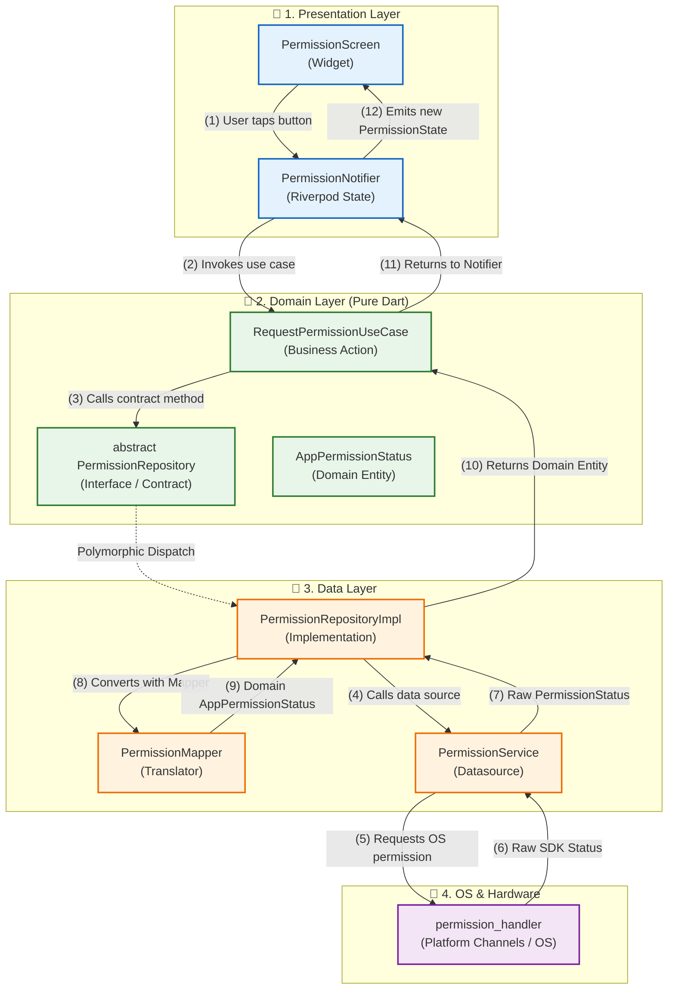
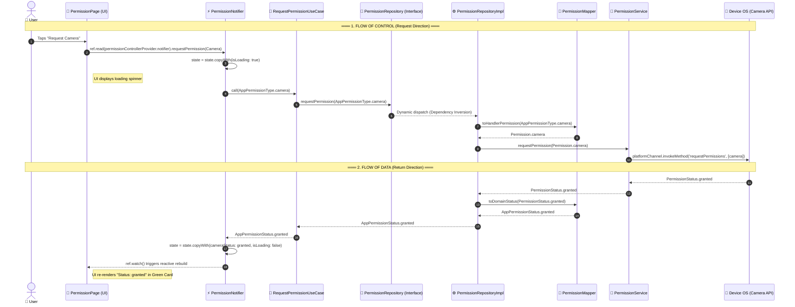

# 🛡️ Flutter Clean Architecture & Riverpod Guide (Permission Feature)

A practical, beginner-friendly reference application demonstrating **Clean Architecture** combined with **Flutter Riverpod** for robust, testable, and maintainable state management and dependency injection.

---

## 📁 Directory Structure Overview

```text
lib/
├── core/
│   └── di/
│       └── permission_providers.dart        # Dependency Injection (Riverpod Providers)
│
├── data/                                    # Data Layer (External APIs / SDKs)
│   └── permission/
│       ├── datasources/
│       │   └── permission_service.dart      # Talks directly to permission_handler package
│       ├── mappers/
│       │   └── permission_mapper.dart       # Converts 3rd-party types <-> Domain entities
│       └── repositories/
│           └── permission_repository_impl.dart # Implements Domain Repository contract
│
├── domain/                                  # Domain Layer (Pure Business Logic)
│   └── permission/
│       ├── entities/
│       │   └── app_permission.dart          # Pure Dart models & Enums (No Flutter/3rd-party code)
│       ├── repositories/
│       │   └── permission_repository.dart   # Abstract contract (interface)
│       └── usecases/
│           ├── get_permission_status.dart   # Single business action: check status
│           ├── request_permission.dart      # Single business action: request permission
│           └── open_app_settings.dart       # Single business action: open phone settings
│
├── presentation/                            # Presentation Layer (UI & State)
│   └── permission/
│       ├── controllers/
│       │   └── permission_controller.dart   # Riverpod Notifier & UI State
│       ├── pages/
│       │   └── permission_page.dart         # ConsumerStatefulWidget / UI Screen
│       └── widgets/
│           └── permission_card.dart         # Reusable UI components
│
└── main.dart                                # App Entrypoint wrapped in ProviderScope
```

---

## 📊 Flow of Control vs. Flow of Data

In Clean Architecture, it is essential to distinguish between **how control travels forward** (Flow of Control) and **how data travels backward** (Flow of Data).

### 1. Architectural Flowchart



---

### 2. Step-by-Step Sequence Diagram



---

## 🏛️ The Golden Rules of Clean Architecture

1. **The Dependency Rule**: Source code dependencies must point **inward** toward the Domain layer.
2. **Domain is King**: The `domain/` folder contains **zero UI code and zero 3rd-party package dependencies**. It is written in pure Dart.
3. **Data Implements Domain Contracts**: The `data/` folder implements the interfaces defined by `domain/`.
4. **Presentation Never Touches Data Directly**: UI and Controllers only interact with **Use Cases** and **Entities** from the `domain/` layer.

---

## 📂 What Goes in Each Folder?

### 1. 🏢 Domain Layer (`lib/domain/`)
*The heart of your application. Pure business rules.*

| Subfolder | What to Keep Here | Why? |
| :--- | :--- | :--- |
| **`entities/`** | Pure Dart classes, models, and enums (e.g. `AppPermission`, `AppPermissionStatus`, `AppPermissionType`). | Protects your core business logic from breaking changes in external libraries. |
| **`repositories/`** | **`abstract class`** interfaces only (e.g. `abstract class PermissionRepository`). | Declares *what* actions are possible without specifying *how* they are executed. |
| **`usecases/`** | Small classes with a single responsibility and a `call()` method (e.g. `GetPermissionStatusUseCase`, `RequestPermissionUseCase`). | Keeps business operations isolated, reusable, and easy to unit test. |

---

### 2. 💾 Data Layer (`lib/data/`)
*The engine room. Communicates with device hardware, databases, and network APIs.*

| Subfolder | What to Keep Here | Why? |
| :--- | :--- | :--- |
| **`datasources/`** | Low-level service classes calling external SDKs or APIs (e.g. `PermissionService` calling `permission_handler`). | Isolates 3rd-party library dependencies to a single place. |
| **`mappers/`** | Translators converting 3rd-party SDK data types into clean Domain Entities (e.g. `PermissionStatus` ➔ `AppPermissionStatus`). | Ensures the rest of your app never has to import third-party types. |
| **`repositories/`** | Concrete classes that implement the abstract Domain repository interface (e.g. `PermissionRepositoryImpl`). | Connects data sources and mappers to fulfill domain contracts. |

---

### 3. 🎨 Presentation Layer (`lib/presentation/`)
*The visual interface and user interaction.*

| Subfolder | What to Keep Here | Why? |
| :--- | :--- | :--- |
| **`controllers/`** | State classes and Riverpod Notifiers (e.g. `PermissionState`, `PermissionNotifier`). | Manages UI state, calls Use Cases, and emits state updates. |
| **`pages/`** | Full-screen widgets (`ConsumerWidget` or `ConsumerStatefulWidget`). | Renders the screen layout and binds to controllers. |
| **`widgets/`** | Reusable UI components (e.g. `PermissionCard`, custom buttons, dialogs). | Promotes modular, clean, and reusable UI code. |

---

### 4. ⚙️ Core Layer (`lib/core/`)
*Cross-cutting infrastructure and Dependency Injection.*

| Subfolder | What to Keep Here | Why? |
| :--- | :--- | :--- |
| **`di/`** | Declarative Riverpod providers linking all layers together. | Wires up Data Sources ➔ Repositories ➔ Use Cases ➔ Notifiers in a type-safe, compile-time verified way. |

---

## ⚡ Riverpod Dependency Injection & State Management

### How Providers Connect the Layers:

```dart
// 1. Data Source Provider
final permissionServiceProvider = Provider<PermissionService>((ref) {
  return PermissionService();
});

// 2. Repository Provider (Injects Data Source)
final permissionRepositoryProvider = Provider<PermissionRepository>((ref) {
  final dataSource = ref.watch(permissionServiceProvider);
  return PermissionRepositoryImpl(dataSource: dataSource);
});

// 3. Use Case Provider (Injects Repository)
final requestPermissionUseCaseProvider = Provider<RequestPermissionUseCase>((ref) {
  final repository = ref.watch(permissionRepositoryProvider);
  return RequestPermissionUseCase(repository);
});

// 4. Controller Notifier Provider (Consumes Use Cases)
final permissionControllerProvider =
    NotifierProvider<PermissionNotifier, PermissionState>(
  PermissionNotifier.new,
);
```

---

## 💡 Important Design Decisions

### Why Notifiers Shouldn't Use `BuildContext`:
- **Problem**: Passing `BuildContext` to notifiers or calling `showDialog()` inside a controller couples your business logic to Flutter UI layout.
- **Solution**: Notifiers update pure Dart state (`PermissionState`). The UI observes the state and shows Dialogs or SnackBars based on state changes (or using `ref.listen`). This ensures your controller can be **100% unit-tested** in pure Dart without creating Flutter widget test harnesses.

---

## 🚀 Cheat Sheet: Adding a New Feature in 5 Easy Steps

When adding a new feature (e.g. *Location Tracking* or *User Authentication*), follow these 5 steps:

1. **Domain Entities & Contracts**:
   - Create your model in `domain/<feature>/entities/`.
   - Create the `abstract class <Feature>Repository` in `domain/<feature>/repositories/`.
2. **Domain Use Cases**:
   - Create single-purpose use case classes in `domain/<feature>/usecases/`.
3. **Data Implementation**:
   - Create the data source in `data/<feature>/datasources/`.
   - Create mappers in `data/<feature>/mappers/`.
   - Implement the repository in `data/<feature>/repositories/<feature>_repository_impl.dart`.
4. **Dependency Injection**:
   - Register Riverpod providers in `core/di/` connecting Data ➔ Domain.
5. **Presentation**:
   - Create `State` and `Notifier` in `presentation/<feature>/controllers/`.
   - Build UI pages in `presentation/<feature>/pages/` using `ref.watch()`.

---

## 🛠️ Commands

- Run code analysis:
  ```bash
  flutter analyze
  ```
- Run tests:
  ```bash
  flutter test
  ```
- Run the application:
  ```bash
  flutter run
  ```
